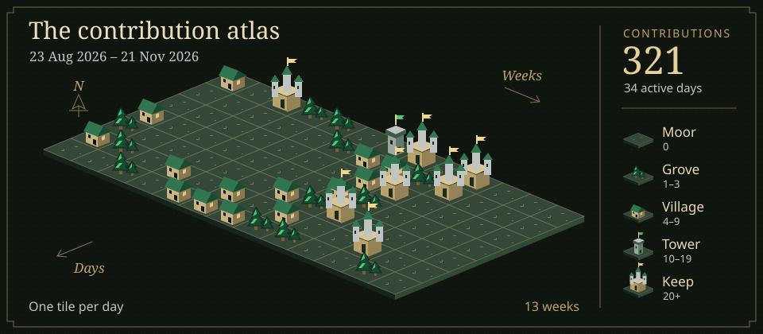

<h1>
  <picture>
    <source media="(max-width: 600px)" srcset="assets/codex/cover-small.png">
    
  </picture>
</h1>

[Featured projects](#legendary-artifacts) · [Awards and speaking](#advancements) · [Contribution atlas](#kingdom-expansion) · [Contact](#the-nether-portal)

## The Architect

I'm **Rohit Srivastava**, a computer engineering student at Rajiv Gandhi Institute of Technology in Mumbai. I build tools for evaluating AI-generated code and applications that keep working offline. For Dastak, that meant putting the visit protocol on the device so a health worker could finish a visit after the connection dropped.

I want to contribute to frontier AI research. For now, I'm learning to design tests that can tell me when my own approach is wrong.

## The Inventory

<table>
<tr><td width="72" align="center"></td><td><strong>Evidence &amp; evaluation</strong> Python, FastAPI and pytest for extracting claims, ranking sources and comparing test outcomes.</td></tr>
<tr><td width="72" align="center"></td><td><strong>Durable state</strong> IndexedDB, SQLite, Node.js and Express for queuing edits offline and detecting conflicts on sync.</td></tr>
<tr><td width="72" align="center"></td><td><strong>Interfaces</strong> TypeScript, JavaScript, React and Next.js for tracing a verdict back to the evidence behind it.</td></tr>
<tr><td width="72" align="center"></td><td><strong>Verification</strong> Docker, Playwright and GitHub Actions for repeating test runs and exercising workflows in a browser.</td></tr>
</table>

## Legendary Artifacts

<table>
<tr><td>
<h3><a href="https://github.com/CodesbyRohit/PatchProofAI">PatchProofAI</a> · A second opinion on a code fix</h3>

A plausible patch fixed both failing pagination tests and broke three that had passed. PatchProofAI caught all three. It runs the original and patched Python suites twice in Docker, compares each test and flags incomplete evidence.

<strong>29 of 29 scripted cases</strong> produced the expected verifier verdict in the recorded CI benchmark. <a href="https://github.com/CodesbyRohit/PatchProofAI/tree/main/benchmark">Benchmark design</a> · <a href="https://github.com/CodesbyRohit/PatchProofAI/actions/runs/40282328735">CI run</a>

</td></tr>
<tr><td>
<h3><a href="https://github.com/CodesbyRohit/Dastak">Dastak</a> · One question in the field of view</h3>

Pratik Sanap and I built a hands-free research prototype for community health workers. A directional pad and one confirm button drive a 600 × 600 display. A pure JavaScript engine follows paths defined in versioned JSON and can resume an interrupted visit offline.

The build checks that every protocol path terminates. The clinical content still needs qualified review. <a href="https://dastak-orpin.vercel.app/showcase.html">Showcase</a> · <a href="https://github.com/CodesbyRohit/Dastak/blob/main/docs/TEST-RESULTS.md">Recorded browser and unit tests</a>

</td></tr>
<tr><td>
<h3><a href="https://github.com/CodesbyRohit/SALAH">SALAH</a> · A ledger a shopkeeper can question</h3>

Which weekday is slow, and what could a merchant try next week? SQLite and Python calculate the answer from synthetic payments. An optional voice interface explains the figures. Each proposed experiment carries a baseline, a measurement window and the things that could confound it.

Tests independently recompute the metrics from raw SQL. <a href="https://salah-liart.vercel.app/">Merchant demo</a> · <a href="https://github.com/CodesbyRohit/SALAH/blob/main/backend/analytics.py">Analytics</a> · <a href="https://github.com/CodesbyRohit/SALAH/blob/main/tests/test_metric_definitions.py">Metric checks</a>

</td></tr>
</table>

**NIRNAY** checks financial messages claim by claim. It redacts common identifiers before model calls and links each assessment to the evidence retrieved for that claim. GDG Baroda lists it in its reviewed community showcase. [Repository](https://github.com/CodesbyRohit/NIRNAY) · [Demo](https://nirnay-blond.vercel.app) · [Showcase](https://devfest.gdgbaroda.com/showcase)

**UrbanBreathe** applies India's National AQI methodology to modelled air-quality data for ten cities. Estimates retain their source and retrieval time through a cache hit. Forecast evaluation is still open. [Repository](https://github.com/CodesbyRohit/UrbanBreathe) · [Demo](https://urban-breathe-nine.vercel.app) · [Evaluation protocol](https://github.com/CodesbyRohit/UrbanBreathe/blob/main/docs/methodology/forecast-evaluation.md)

More engineering work and the UrbanBreathe measurement record

- **Campus Incident Log** persists reports in an IndexedDB outbox and replays idempotent, version-checked writes when the network returns. [Repository](https://github.com/CodesbyRohit/offline-first-incident-log)
- **MediVault** is a Java 17 and Spring Boot student project for fictional medical records, with owner-scoped access and encrypted PDF storage. [Repository](https://github.com/CodesbyRohit/MediVault)
- **NEXUS** traces incident explanations through actual relationships in a FalkorDB graph and writes new facts back into memory. [Repository](https://github.com/CodesbyRohit/NEXUS)
- **UrbanBreathe, 20 October 2026.** The archived measurement records 150 passing tests at commit `714a205`, mobile Lighthouse performance of 95–97 over three production runs, and a cache hit that preserved the original retrieval time. [Measurement record](assets/proof.svg) · [Measured revision](https://github.com/CodesbyRohit/UrbanBreathe/commit/714a20561aec0df0f6cd0886fb4a738e45db6f78)

## Advancements

<table>
<tr><td width="72" align="center"></td><td><strong>Second place · Build The Invisible</strong> Pratik Sanap and I entered Dastak as Team Multiplier. The jury evaluated 24 builds. <a href="https://www.krazyykrunal.com/buildtheinvisible/awards/index.html">Jury podium</a></td></tr>
<tr><td width="72" align="center"></td><td><strong>Problem Solver · CodeChef</strong> Earned the bronze badge for solving 50 programming problems. <a href="https://www.codechef.com/users/cute_rained_59">Coding profile</a></td></tr>
<tr><td width="72" align="center"></td><td><strong>Maintainer work · PatchProofAI</strong> Added the verifier benchmark to CI so contributors can inspect the verdict for every case. <a href="https://github.com/CodesbyRohit/PatchProofAI/commit/3e7f118441fa24567090ed9294b145b356ef9e94">Implementation commit</a></td></tr>
</table>

### Scheduled appearance

 **DevFest Mumbai · 5 December 2026 · Stage 3, 2:15 PM IST**

*When AI Shouldn't Be in the Loop: Engineering Offline-First Workflows.* The companion demo lets you disconnect, file a report and reconnect to watch it sync. [Organizer agenda](https://devfestmumbai.com/) · [Talk demo](https://github.com/CodesbyRohit/offline-first-incident-log)

## Kingdom Expansion

<!-- atlas:begin -->
**23 Aug 2026 – 21 Nov 2026** · 321 contributions across 34 active days.
<!-- atlas:end -->

Read from the north corner. Weeks advance down-right. Days run Sunday to Saturday down-left. A **moor** is 0 contributions, a **grove** 1–3, a **village** 4–9, a **tower** 10–19 and a **keep** 20 or more. [Daily counts](data/contributions.csv) · [Map generator](scripts/atlas.py) · [GitHub calendar](https://github.com/users/CodesbyRohit/contributions)

## Quest Log

- **Evaluate UrbanBreathe's forecast.** Compare predictions with station observations and a persistence baseline, then report errors by lead time. [Evaluation plan](https://github.com/CodesbyRohit/UrbanBreathe/blob/main/docs/methodology/forecast-evaluation.md)
- **Verify persistent storage in MediVault.** Exercise the MySQL 8.4 integration and Flyway migrations with fictional records. [Milestone status](https://github.com/CodesbyRohit/MediVault)

## The Grimoire

**Keep the baseline.** A fix earns its place when the original failure disappears and previously passing tests still pass.

**Keep the source.** A reader should be able to follow a number back to the observation, calculation or model that produced it.

**Design for the interruption.** On a field visit, the next question should still be there after the connection drops. That requirement determines where the protocol and the visit state belong.

## The Nether Portal

For engineering collaborations, open-source work or a conversation after a talk, reach me by [email](mailto:rsironman0210@gmail.com) or [LinkedIn](https://www.linkedin.com/in/rohit-srivastava-639358353/).

[Portfolio](https://portfolio1-theta-tan.vercel.app) · [GitHub](https://github.com/CodesbyRohit)

**Competitive programming** · [CodeChef](https://www.codechef.com/users/cute_rained_59) · [HackerRank](https://www.hackerrank.com/profile/rsironman0210) · [LeetCode](https://leetcode.com/u/IronManRohitCodeWarrior/)

