  

  <a href="https://urban-breathe-nine.vercel.app">UrbanBreathe</a> ·
  <a href="https://nirnay-blond.vercel.app">NIRNAY</a> ·
  <a href="https://dastak-orpin.vercel.app/showcase.html">Dastak</a> ·
  <a href="https://portfolio1-theta-tan.vercel.app">Portfolio</a> ·
  <a href="https://www.linkedin.com/in/rohit-srivastava-639358353">LinkedIn</a>

I'm Rohit, a Computer Science student at RGIT, Mumbai. I build software that has to be honest about what it knows: AI pipelines that cite their evidence, data products that label their sources and uncertainty, and workflows that keep working when the network — or the model — doesn't.

Long term, I want to contribute to frontier AI research. Right now I'm building the foundations for it: careful engineering, evaluation, and measuring before claiming.

## Featured engineering

### [UrbanBreathe](https://github.com/CodesbyRohit/UrbanBreathe) — air-quality estimates that show their provenance

`TypeScript` `React` `Express` `Vercel` · [live ↗](https://urban-breathe-nine.vercel.app)

Applies the CPCB National AQI method to modelled CAMS data for ten Indian cities, and labels every number with its source, time and method.

- NAQI calculation with averaging windows, data-completeness rules and documented open questions; modelled estimates are never presented as official station AQI.
- Race-safe data loading, cache hits that keep their original retrieval time, and illustrative scenarios whose assumptions are editable and labelled.
- 150 automated tests on `main`; production verified on 20 Oct 2026. The forecast is **not yet evaluated**; an evaluation protocol is drafted.

### [NIRNAY](https://github.com/CodesbyRohit/NIRNAY) — check financial claims against evidence

`Python` `FastAPI` `Next.js` `TypeScript` · [site ↗](https://nirnay-blond.vercel.app)

For Indian retail investors: splits a message into atomic claims, retrieves evidence for each one, and assesses every claim only against its own evidence.

- Processing is consent-gated; obvious identifiers (email, phone, PAN, Aadhaar) are redacted locally before any hosted model sees the text.
- LLM and search providers sit behind replaceable interfaces; evidence ranking and a manipulation-signal scanner (urgency, guaranteed returns, insider language) are deterministic and inspectable.
- pytest suite covering analysis, evidence, assessment and manipulation signals. Not investment advice; no accuracy figures are claimed.

### [Dastak](https://github.com/CodesbyRohit/Dastak) — a hands-free field-visit workflow

`JavaScript` `Node.js` `Playwright` · [showcase ↗](https://dastak-orpin.vercel.app/showcase.html)

One question at a time on a 600 × 600 head-worn display, for community health workers whose hands are busy.

- Protocols are JSON data, checked for schema, graph structure, lifecycle and source-to-bundle drift on every build, then run by a pure engine with no DOM, storage or network access.
- The visit page makes no outgoing connections (CSP `connect-src 'none'`); optional AI is confined to clearly separated, non-clinical helpers.
- Unit and Playwright end-to-end tests. A research prototype: not clinically validated and not deployed in care.

### More projects

- **[MediVault](https://github.com/CodesbyRohit/MediVault)** — a personal medical-records vault in Spring Boot (Java 17): owner-only records with Spring Security, Flyway migrations (MySQL integration still in progress), and PDFs encrypted at rest with Google Tink streaming AEAD. 57 JUnit test classes. A student project for fictional data only; not production-ready.
- **[offline-first-incident-log](https://github.com/CodesbyRohit/offline-first-incident-log)** — incident reporting that works with no network: an IndexedDB outbox synced to an Express + `node:sqlite` backend with idempotent, version-checked requests; an optional AI summary can fail without affecting reporting. `node:test` and Playwright suites.
- **[NEXUS](https://github.com/CodesbyRohit/NEXUS)** — graph-native agent memory: an incident-commander agent that traverses a FalkorDB graph before deciding, backs its important answers with an evidence path of real graph relationships, and writes new facts back. FastAPI + React, pytest suite.

## Proof of work

  

The same facts in text — measured on 20 Oct 2026 and not updated automatically:

- **UrbanBreathe tests:** `npm test` on `main` at `714a205` — 150 tests, 150 passing.
- **Production performance:** Lighthouse 12.8.2 against <https://urban-breathe-nine.vercel.app>, three runs each — mobile performance 95–97 with accessibility, best practices and SEO at 100; desktop 100 in every category.
- **Honest caching:** two identical API requests returned CDN `MISS` then `HIT`, and the cached response kept its original `retrievedAt`.

## Engineering stack

Only what the repositories above actually use.

| Area | Tools |
|---|---|
| Languages | TypeScript, JavaScript, Python, Java, C |
| Back end | Node.js + Express, FastAPI, Spring Boot (Security, Data JPA, Flyway) |
| Front end | React, Next.js, Vite, Tailwind CSS |
| Data | SQLite (`node:sqlite`), IndexedDB, H2 / MySQL, FalkorDB |
| AI integration | Hosted LLM APIs behind replaceable interfaces, evidence-grounded assessment |
| Testing & delivery | `node:test`, pytest, JUnit, Playwright, Lighthouse, Vercel |

## How I work

- **Measure before claiming.** If something hasn't been evaluated, the product says so.
- **Label the data.** Modelled, measured, demo and hypothetical values are never mixed silently.
- **Fail visibly.** When a dependency is down, show that — not a plausible-looking substitute.

## Connect

[Portfolio](https://portfolio1-theta-tan.vercel.app) · [LinkedIn](https://www.linkedin.com/in/rohit-srivastava-639358353) · [GitHub](https://github.com/CodesbyRohit)

The banner, terminal and dividers are hand-written SVGs in <code>assets/</code>: no third-party widgets, no tracking, no scripts. Animation is decorative; every image shows its full content when motion is off.
